# Assets do Jatinho do Flávio — estado atual

Todos os desenhos hoje são **feitos em código** (formas simples no Canvas 2D), sem nenhuma
imagem. Este documento mostra cada um isolado para você analisar e decidir o que melhorar.

> Para gerar os prints de novo: `npm run dev` e, em outro terminal,
> `node tools/capture-assets.cjs`. A folha com tudo junto fica em
> http://localhost:5173/tools/asset-sheet.html

Em cada item: **onde está no código**, **o que eu vejo** e um espaço para a sua opinião.

---

## 1. Jatinho (jogador)

| Reto | Subindo | Caindo |
| :-: | :-: | :-: |
| 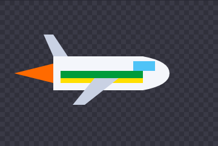 | 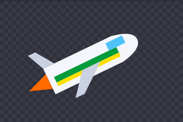 | 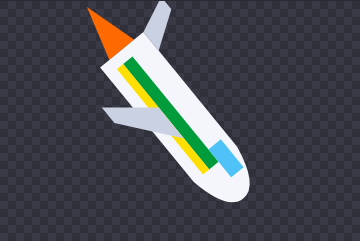 |

- Código: `src/entities/jet.ts` (`render`). Inclina conforme a velocidade; chama da turbina pisca.
- O que eu vejo:
  - Lê bem como avião, mas é bem "chapado": sem contorno, sem janelinhas, sem piloto.
  - Sem contorno, ele some um pouco no céu claro de Brasília.
  - Caindo, ele aponta quase reto para baixo. Pode ser exagero.
  - A faixa verde-amarela é o único detalhe de identidade.
- Ideias: contorno escuro, janelinhas, piloto caricato (só o topo da cabeça), chama maior ao tocar,
  rastro de fumaça.
- Sua opinião: ☐ manter ☐ melhorar ☐ refazer — _______________________

## 2. Perseguidores

| Lula | Xandão | Renan Santos |
| :-: | :-: | :-: |
| 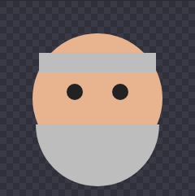 | 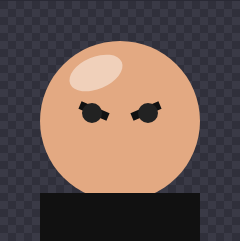 | 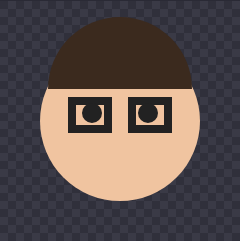 |

- Código: `src/entities/chaser.ts` (`CHASERS` e `drawChaserHead`).
- O que eu vejo:
  - São só **cabeças flutuando**: círculo de pele, dois olhos e um detalhe cada
    (barba grisalha, careca brilhando com sobrancelha franzida, cabelo e óculos).
  - Nenhum tem boca nem expressão, e o rosto do Lula fica quase todo coberto pela barba.
  - Os três são do mesmo tamanho e formato. De longe, só a cor do detalhe diferencia.
- Ideias: corpo ou veículo para cada um (carro oficial, toga voando, moto ou drone), expressões
  (bravo, rindo), animação ao avançar, e o ataque de cada um já desenhado (decreto, caneta, drone).
- Sua opinião: ☐ manter ☐ melhorar ☐ refazer — _______________________

## 3. HUD: perseguidor e barra de perigo

| Perigo baixo | Médio | Alto |
| :-: | :-: | :-: |
| 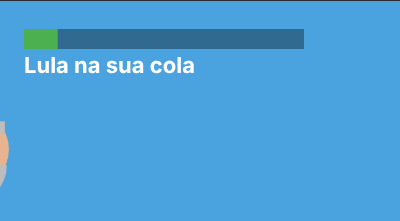 | 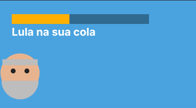 | 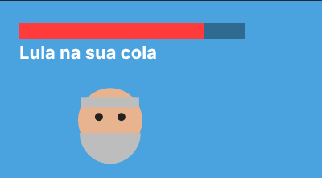 |

- Código: `src/entities/chaser.ts` (`render`).
- O que eu vejo:
  - A barra muda de cor (verde, amarelo, vermelho), mas não tem ícone nem moldura.
  - Com perigo baixo, o perseguidor fica quase todo fora da tela (de propósito, mas some demais).
  - O texto "Lula na sua cola" é pequeno.
- Ideias: ícone da cabeça do perseguidor no começo da barra, moldura, tremer quando passa de 66%.
- Sua opinião: ☐ manter ☐ melhorar ☐ refazer — _______________________

## 4. Obstáculos

| Barreira de toga | Balões da CPI | Helicóptero da PF | Radar |
| :-: | :-: | :-: | :-: |
| 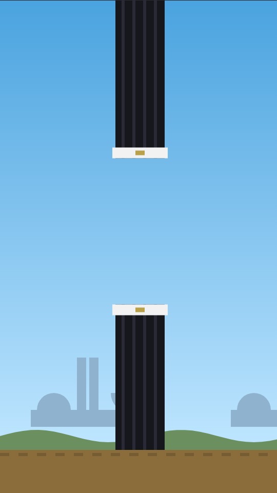 | 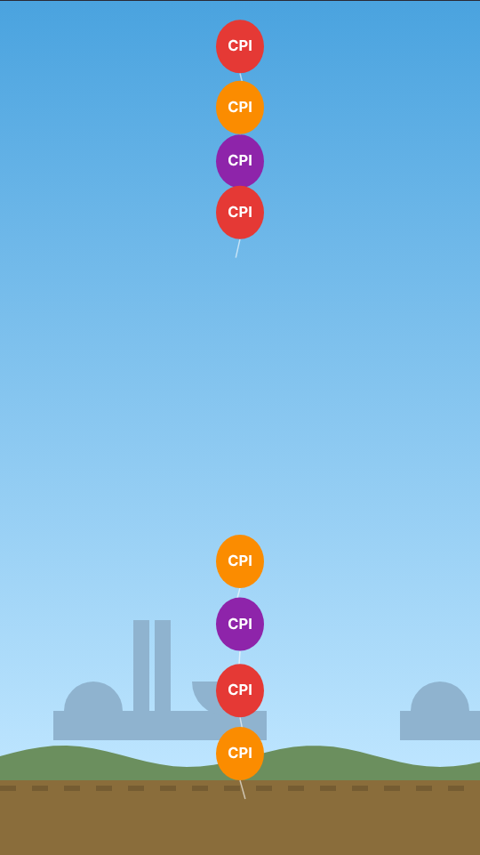 | 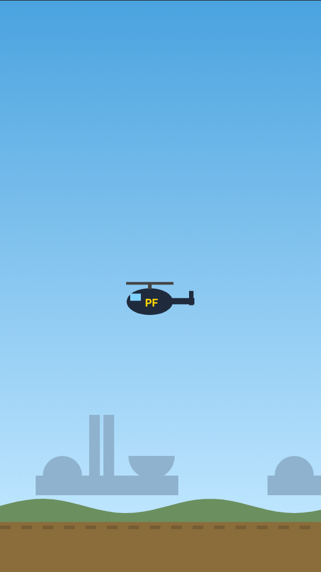 | 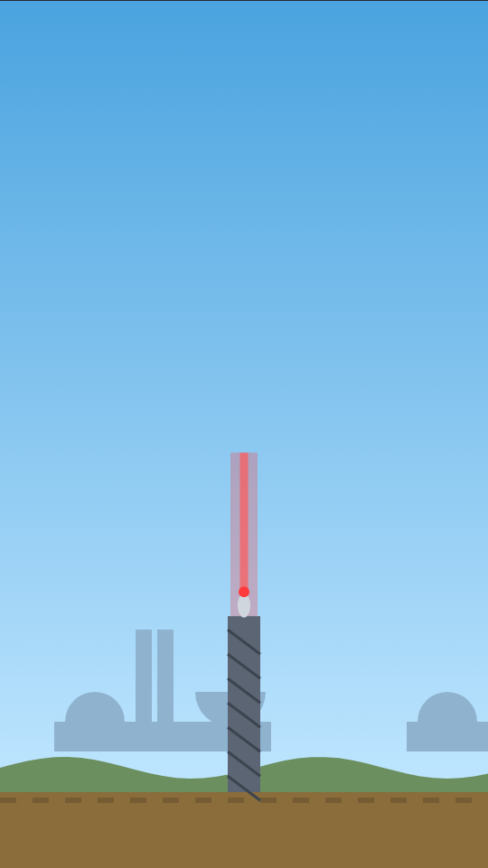 |

- Código: `src/entities/obstacles.ts`.
- O que eu vejo:
  - **Barreira de toga**: é o mais fraco. Parece duas colunas pretas com uma gola branca.
    Lembra muito "cano de cima e de baixo", que é justamente o que o jogo quer evitar.
  - **Balões da CPI**: cores boas e se leem bem. A coluna fica um pouco "parede".
  - **Helicóptero da PF**: pequeno para o tamanho da tela, e a hélice é só um traço.
  - **Radar**: a torre é simples e o feixe parece mais um laser rosa do que um radar.
- Ideias:
  - toga: tecido com dobras de verdade, mangas e um martelo de juiz pendurado; ou trocar por
    uma pilha de processos/papéis;
  - CPI: balões de tamanhos diferentes e cordinhas presas num ponto;
  - PF: maior, com holofote e hélice com efeito de movimento;
  - radar: feixe em cone, que gira, com prato de antena de verdade.
- Sua opinião: ☐ manter ☐ melhorar ☐ refazer — _______________________

## 5. Fundos das regiões

| Brasília (0+) | Litoral (20+) | Oceano (40+) | Fronteira (60+) |
| :-: | :-: | :-: | :-: |
| 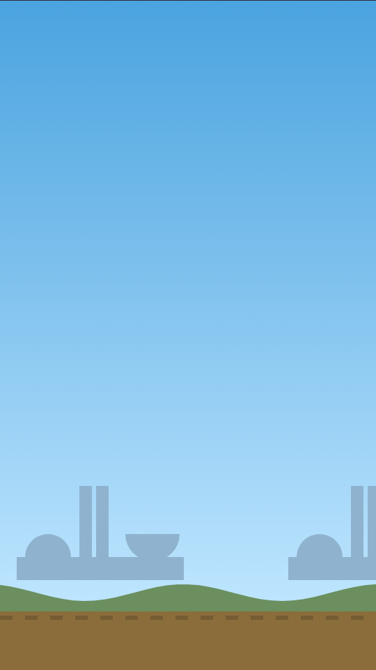 | 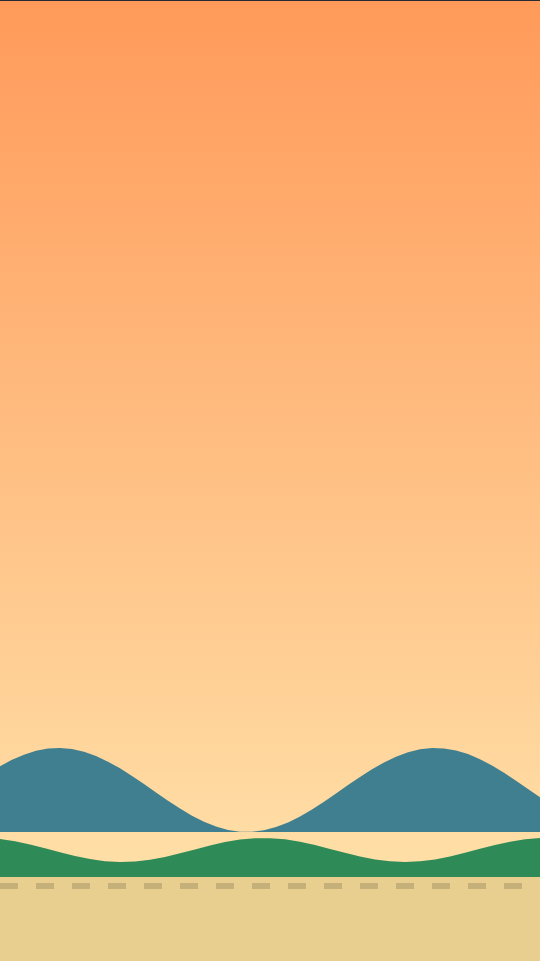 | 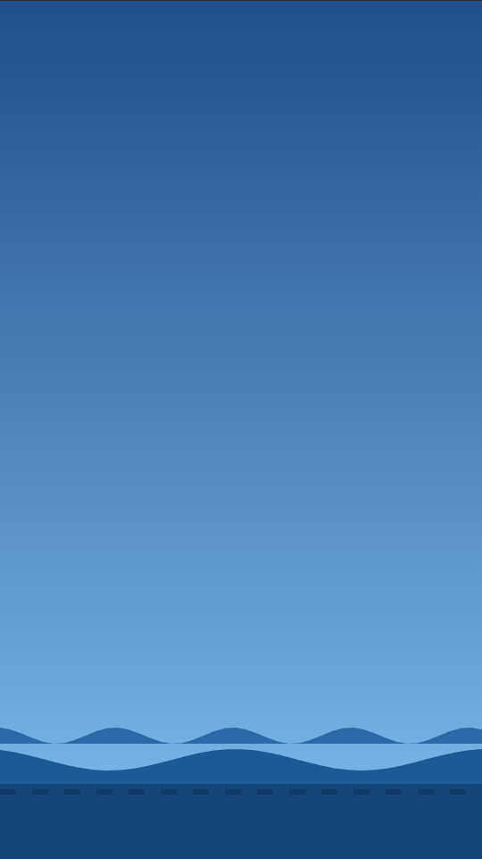 | 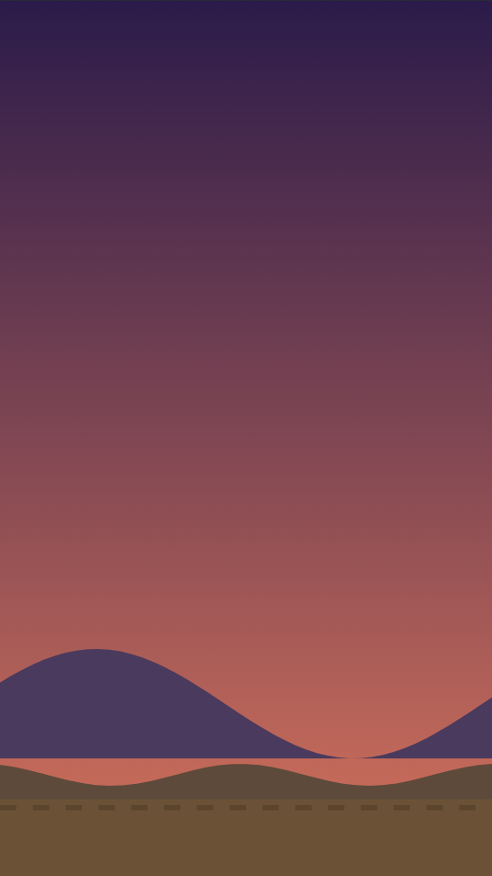 |

- Código: `src/render/stages.ts` (cores e silhuetas) e `src/render/background.ts` (camadas).
- O que eu vejo:
  - São só 3 camadas: degradê do céu, uma silhueta distante e morrinhos + chão. Não tem nuvens, sol,
    nem nada no céu, que ocupa 80% da tela.
  - **Brasília**: a silhueta do Congresso funciona, mas se repete com buracos no meio.
  - **Litoral**: não tem mar! São morros verdes e areia. Falta água, coqueiros, prédios da orla.
  - **Oceano**: o "chão" azul-escuro tem os mesmos tracinhos do chão de terra, o que parece estranho
    na água. Faltam ondas de verdade, navios, ilhas.
  - **Fronteira**: montanhas roxas bonitas, mas nada diz "fronteira" (cerca, placa, marco, posto).
- Ideias: nuvens em parallax, sol/lua, mais uma camada de silhueta; marcos de cada região
  (Esplanada e Catedral; orla com coqueiros; navio e ilha; cerca, placa "FRONTEIRA" e posto).
- Sua opinião: ☐ manter ☐ melhorar ☐ refazer — _______________________

## 6. Mapa da rota (pausa e landing)

| Início | No Litoral | Na Fronteira |
| :-: | :-: | :-: |
| 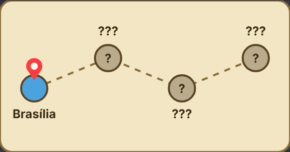 | 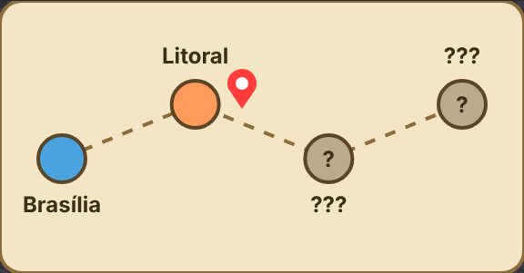 | 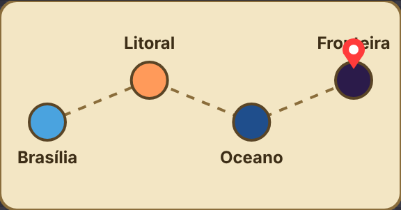 |

- Código: `src/render/map.ts`.
- O que eu vejo:
  - Funciona como "esquema": bolinhas ligadas por tracejado, com nomes ou ???.
  - Na Fronteira o pino vermelho fica **em cima do nome** ("Fronteira" aparece cortado).
  - Não parece um mapa: não tem contorno do Brasil, mar ou relevo.
- Ideias: mapa estilizado do Brasil com a rota de Brasília até a fronteira, ícones por região,
  avião pequeno no lugar do pino, regiões não visitadas "na névoa".
- Sua opinião: ☐ manter ☐ melhorar ☐ refazer — _______________________

## 7. Telas do jogo

| Menu | Jogando | Pausa | Fim de jogo |
| :-: | :-: | :-: | :-: |
| 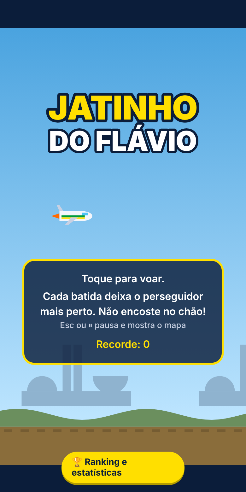 | 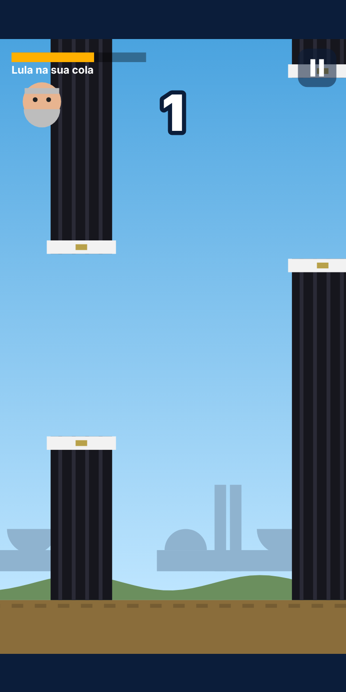 | 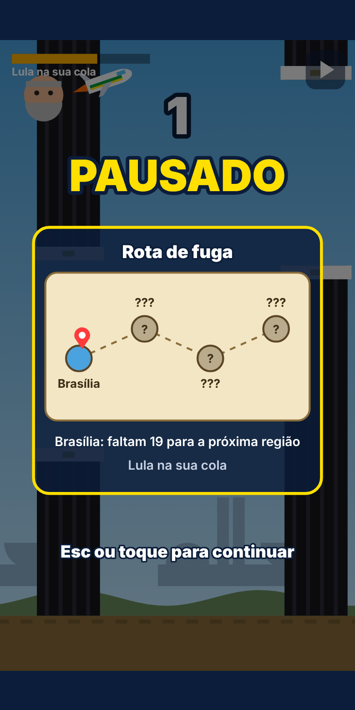 | 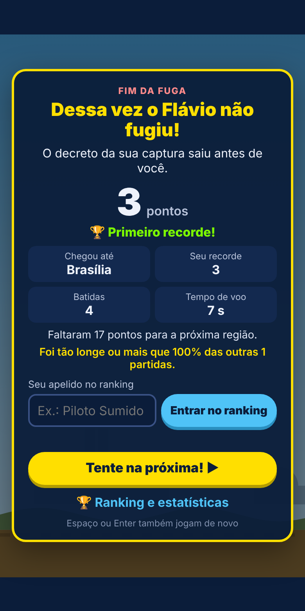 |

- Código: `src/scenes/` (menu, jogo, pausa) e `src/ui/` (fim de jogo).
- O que eu vejo:
  - **Menu**: título forte. O botão "Ranking e estatísticas" quebra em duas linhas e fica em cima do chão.
  - **Menu**: o símbolo ⏸ em "Esc ou ⏸ pausa" aparece como um quadradinho (a fonte do canvas não
    tem esse símbolo). **Bug.**
  - **Jogando**: o placar grande no meio às vezes fica atrás dos obstáculos.
  - **Pausa**: "PAUSADO" fica em cima do placar, e o texto "Lula na sua cola" do HUD aparece por baixo.
  - **Fim de jogo**: "das outras 1 partidas" deveria ser "da outra partida". **Bug** de plural.
- Sua opinião: ☐ manter ☐ melhorar ☐ refazer — _______________________

## 8. Site

| Landing (celular) | Landing (computador) | Ranking (celular) |
| :-: | :-: | :-: |
| 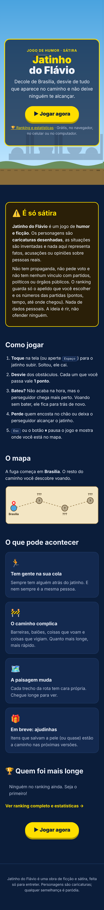 | 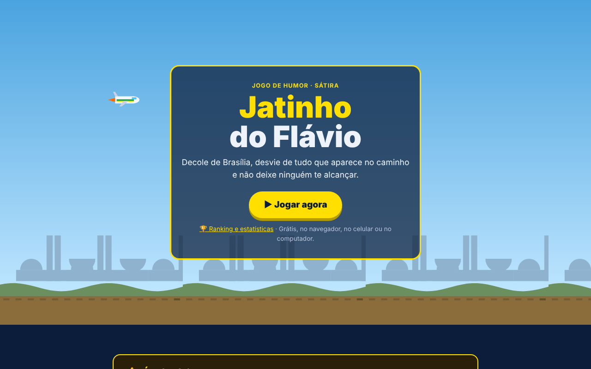 | 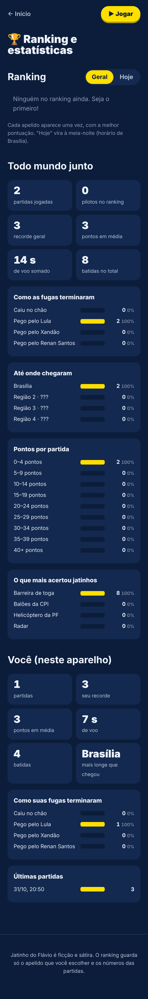 |

- Código: `index.html` + `src/landing/`, `ranking.html` + `src/ranking/`.
- O que eu vejo:
  - Landing no computador: o fundo animado se repete lado a lado e aparece uma **emenda** nos morros.
  - Falta uma imagem de destaque (jatinho grande com os perseguidores atrás) e um ícone/favicon.
- Sua opinião: ☐ manter ☐ melhorar ☐ refazer — _______________________

---

## Decisão principal: como fazer os novos desenhos

1. **Continuar desenhando em código, mais caprichado** (contornos, sombras, mais detalhes).
   É rápido e não pesa, mas tem limite de quão bonito fica.
2. **Ilustrações em SVG** (vetor, estilo cartoon) carregadas como imagem. ✅ É a que eu recomendo:
   fica nítido em qualquer tela, dá para editar num programa como Figma ou Inkscape, e eu
   consigo criar e ajustar os arquivos daqui.
3. **Arte feita por você ou por um ilustrador** (PNG/SVG). Eu deixo o jogo pronto para receber
   os arquivos com nomes e tamanhos definidos.

Sua escolha: ☐ 1 ☐ 2 ☐ 3 — _______________________

## Bugs vistos nos prints (correção rápida)

- [ ] Símbolo ⏸ vira quadradinho no texto do menu.
- [ ] "das outras 1 partidas" → "da outra partida".
- [ ] Botão "Ranking e estatísticas" do menu quebra em duas linhas.
- [ ] Pino do mapa cobre o nome da região.
- [ ] Emenda no fundo animado da landing (computador).
