# Assets do Jatinho do Flávio — pixel art

Tudo no jogo é **pixel art feita em código** (sem arquivos de imagem). A arte é desenhada em
**meia resolução** — 1 pixel da arte = 2 unidades do jogo (tela de 180×320 pixels de arte) — e
ampliada sem borrar. Todos os elementos têm contorno escuro de 1 pixel.

> Para gerar os prints de novo: `npm run dev` e, em outro terminal,
> `node tools/capture-assets.cjs`. A folha com tudo junto fica em
> http://localhost:5173/tools/asset-sheet.html

Em cada item: **onde está no código** e um espaço para a sua opinião.

---

## Novidades: perseguidores dos partidos, obstáculos e aviões

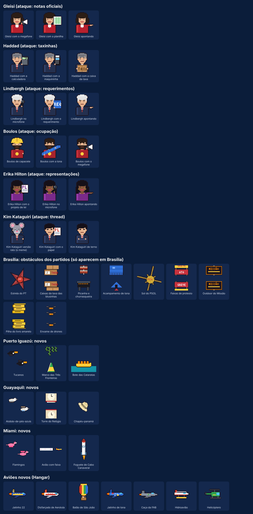

- **6 perseguidores novos** (3 variantes cada): Gleisi, Haddad, Lindbergh, Boulos, Erika Hilton e
  Kim Kataguiri (incluindo o Kim "versão rato", do meme). Paradas: Gleisi, Lindbergh, Boulos e Erika
  em Brasília; Kim e Haddad (a "taxa" na fronteira) em Puerto Iguazú; todos em Miami.
- **Obstáculos dos partidos só em Brasília**: estrela do PT, caixas da taxa das blusinhas, picanha,
  acampamento de lona, sol do PSOL, faixas de protesto, outdoor do Missão, livro amarelo e drones.
- **Regionais novos**: Iguazú (tucanos, Marco das Três Fronteiras, bote), Guayaquil (atobás,
  Torre do Relógio, chapéu-panamá), Miami (flamingos, avião com faixa, foguete de Cabo Canaveral).
- **7 aviões novos** no Hangar. Prancha gerada por `tools/novidades.html`.

## 1. Telas do jogo

| Menu | Jogando | Pausa | Fim de jogo |
| :-: | :-: | :-: | :-: |
|  |  |  |  |

- Código: `src/scenes/` (menu, jogo, pausa) e `src/ui/` (fim de jogo, em HTML com visual retrô).
- Títulos, placar, avisos e HUD usam a **fonte pixel 3×5** (`src/render/pixel-font.ts`), com
  acentos. Textos longos (fim de jogo, landing, ranking) ficam na fonte normal para ler melhor.
- Sua opinião: ☐ manter ☐ melhorar ☐ refazer — _______________________

## 2. Jatinho

| Reto | Subindo | Caindo |
| :-: | :-: | :-: |
|  |  |  |

- Código: `src/entities/jet.ts`. 30×16 pixels, com janelinhas, cabine, faixa verde-amarela e chama
  em 2 quadros. A inclinação usa 10 ângulos pré-desenhados (girados pixel a pixel, sem borrar).
- Sua opinião: ☐ manter ☐ melhorar ☐ refazer — _______________________

## 3. Perseguidores (8, com 3 variantes sorteadas cada)

| | Variante 1 | Variante 2 | Variante 3 |
| --- | :-: | :-: | :-: |
| **Lula** |  de terno |  com o decreto |  com a picanha |
| **Xandão** |  de braços cruzados |  com a caneta |  com o martelo |
| **Janja** |  Constituição aberta | 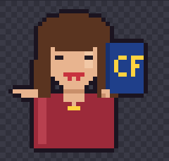 apontando a Constituição | 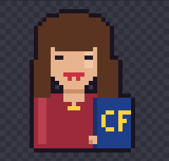 Constituição debaixo do braço |
| **Agente da PF** | 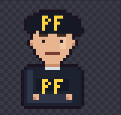 de colete | 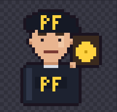 com o distintivo | 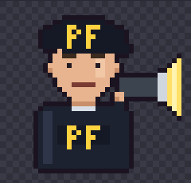 com a lanterna |
| **Renan Santos** |  com o livro amarelo |  guitarrista |  com as fraldas (LULA e FLÁVIO) |
| **Gonet** | 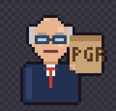 com a pasta da PGR |  com o carimbo |  de braços cruzados |
| **Dino** | 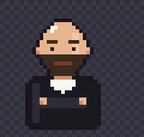 de toga | 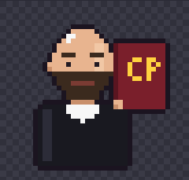 com o Código Penal | 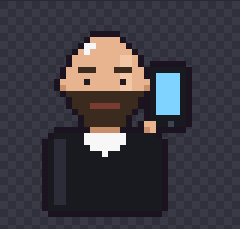 no celular |
| **Agente da Interpol** | 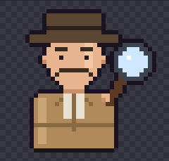 com a lupa | 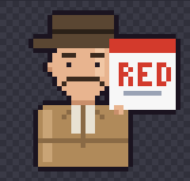 com o alerta vermelho | 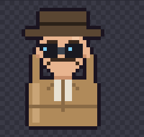 de binóculo |

- Código: `src/entities/chaser-sprites.ts`. Meio corpo 36×34, semelhança só sugerida; agentes da PF e da
  Interpol são genéricos. Cada parada tem o seu grupo (ver `PLANO.md`).
- Sua opinião: ☐ manter ☐ melhorar ☐ refazer — _______________________

## 4. HUD: barra de perigo

| Baixo | Médio | Alto |
| :-: | :-: | :-: |
|  |  |  |

- Código: `src/entities/chaser.ts`. Barra com moldura pixel; verde → amarelo → vermelho, com
  brilho no topo; no vermelho o nome treme.
- Sua opinião: ☐ manter ☐ melhorar ☐ refazer — _______________________

## 5. Obstáculos (16, 4 por parada)

| Parada | 1 | 2 | 3 | 4 |
| --- | :-: | :-: | :-: | :-: |
| **Brasília** |  Toga e processos |  Balões da CPI |  Cúpulas do Congresso |  Helicóptero da PF |
| **Puerto Iguazú** | 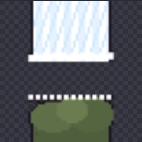 Jatos d'água | 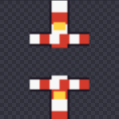 Cancela da ponte | 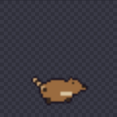 Quatis | 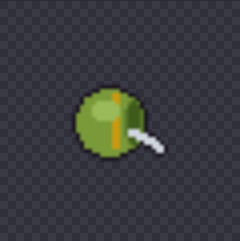 Cuia de chimarrão |
| **Guayaquil** | 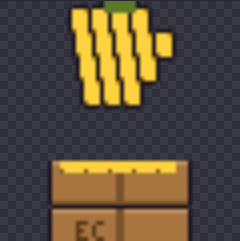 Bananas do porto | 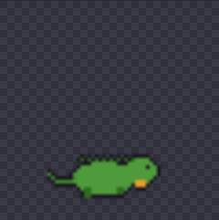 Iguanas | 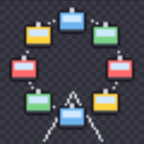 Roda-gigante La Perla |  Torre de controle |
| **Miami** | 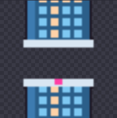 Prédios de Brickell | 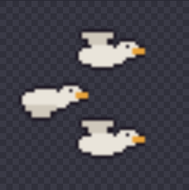 Pelicanos | 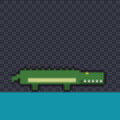 Jacaré | 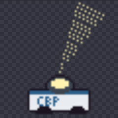 Holofote da imigração |

No jogo, em movimento:

| Roda-gigante | Jatos d'água | Holofote | Pelicanos |
| :-: | :-: | :-: | :-: |
| 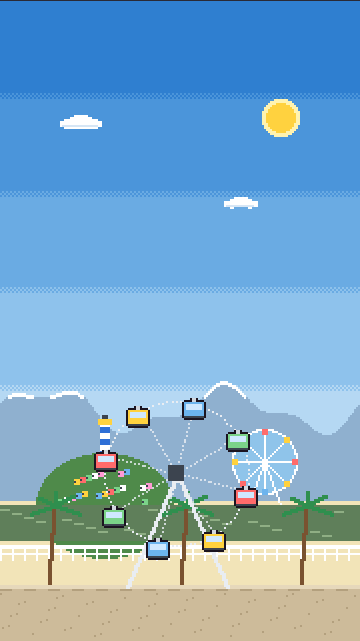 | 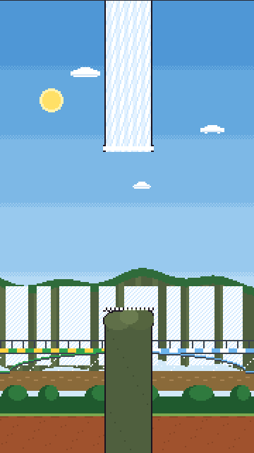 | 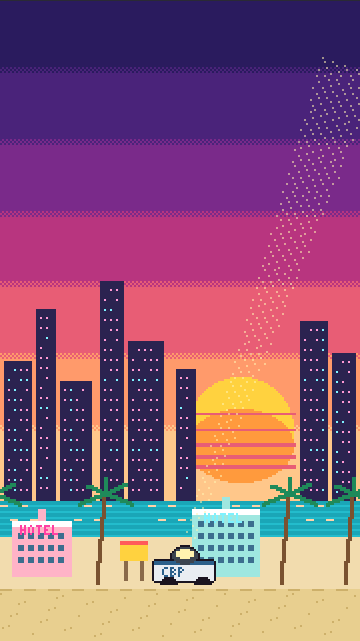 | 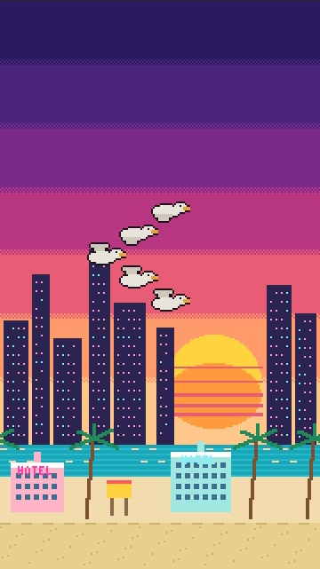 |

- Código: `src/entities/obstacles.ts` e `obstacles-extra.ts` (comportamento e áreas de batida),
  `obstacle-sprites*.ts` (desenhos), `obstacle-preview.ts` (miniaturas).
- Sua opinião: ☐ manter ☐ melhorar ☐ refazer — _______________________

## 6. Fundos das paradas (rota real)

| Brasília (0+) | Puerto Iguazú (40+) | Guayaquil (80+) | Miami (120+) |
| :-: | :-: | :-: | :-: |
|  |  |  |  |

- Código: `src/render/scenery.ts`. Céu fixo, sol e 3–5 camadas que andam em velocidades diferentes.
- **Brasília**: Congresso, Catedral, cerrado e terra vermelha.
- **Puerto Iguazú (Argentina)**: Cataratas, Ponte Tancredo Neves metade verde-amarela e metade azul e
  branca, rio e mata.
- **Guayaquil (Equador)**: Andes, Cerro Santa Ana com casinhas e farol, roda-gigante do Malecón, rio
  Guayas, palmeiras.
- **Miami (EUA)**: pôr do sol neon, prédios de Brickell, mar turquesa, hotéis art déco, palmeiras.
- Sua opinião: ☐ manter ☐ melhorar ☐ refazer — _______________________

### Trechos de viagem (transição entre paradas)

| Estrada até Foz | Sobrevoo dos Andes | Mar do Caribe |
| :-: | :-: | :-: |
| 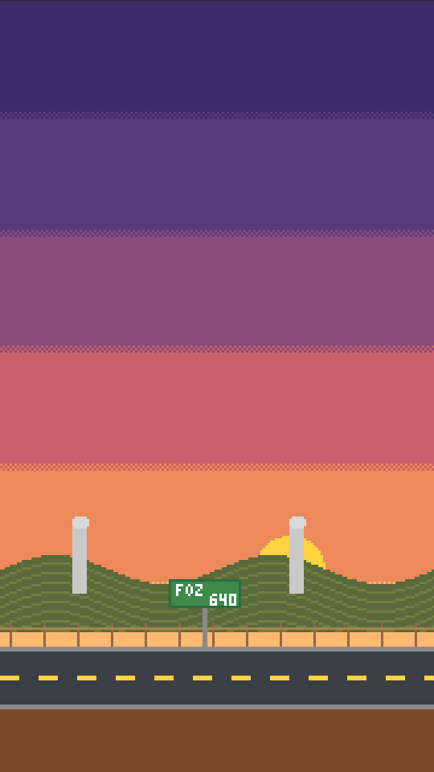 | 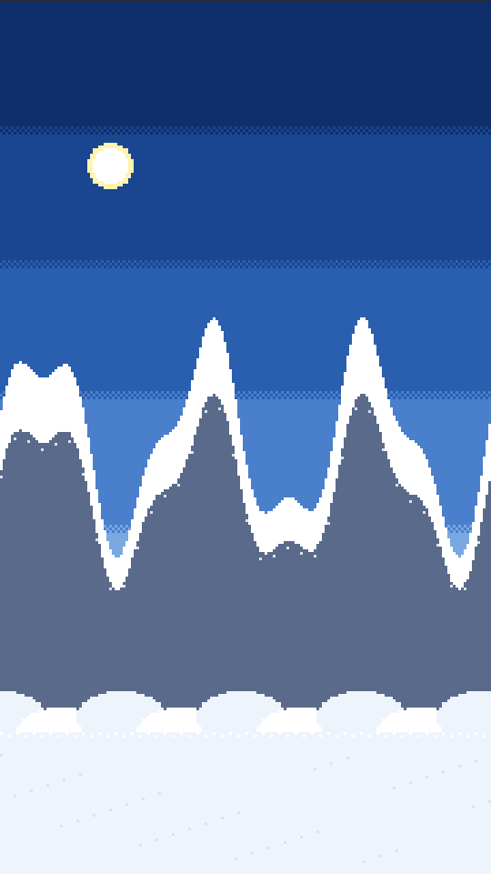 | 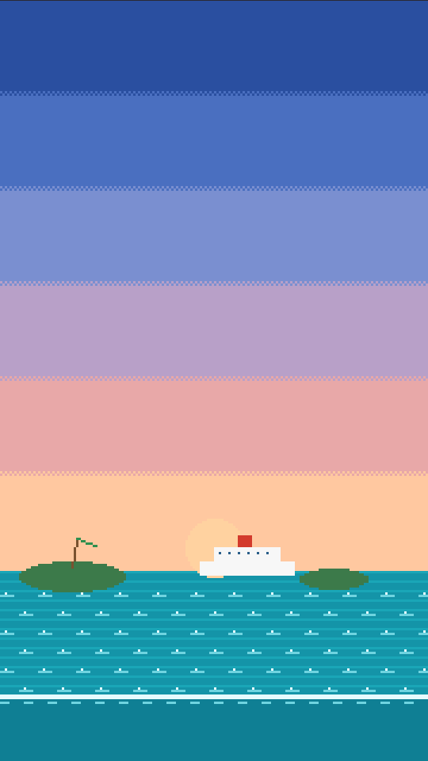 |

Na troca de parada a câmera passa por: cidade antiga → trecho de viagem → cidade nova (5 s), com o céu
mudando aos poucos.

## 7. Mapa das Américas (pausa e landing)

| Saindo de Brasília | Indo para Guayaquil | Em Miami |
| :-: | :-: | :-: |
|  |  |  |

- Código: `src/render/map.ts` e `src/render/americas.ts` (contorno das Américas e a rota real).
- Oceano azul e continente verde em pixel, recortado na América Latina e no Golfo do México.
  Rota feita em vermelho, próxima perna pontilhada, paradas futuras como "?", nomes ao lado de cada
  parada e aviãozinho na posição. (Testamos um estilo "mosaico" com países coloridos e voltamos para este.)
- Sua opinião: ☐ manter ☐ melhorar ☐ refazer — _______________________

## 8. Site

| Landing (celular) | Landing (computador) | Ranking (celular) |
| :-: | :-: | :-: |
|  |  |  |

- A landing usa o fundo e o jatinho em pixel no topo e o mapa em pixel; o sol aparece uma vez só
  mesmo em tela larga.
- Sua opinião: ☐ manter ☐ melhorar ☐ refazer — _______________________

---

## Ideias para a próxima rodada

- Animação dos perseguidores (piscar, balançar o objeto) e dos ataques (decreto, caneta, drone).
- Obstáculos próprios de cada região (guarda-sol, gaivotas, navio, holofote na cerca).
- Favicon e imagem de compartilhamento (jatinho com os perseguidores atrás).
