# Assets do Jatinho do Flávio — pixel art

Tudo no jogo é **pixel art feita em código** (sem arquivos de imagem). A arte é desenhada em
**meia resolução** — 1 pixel da arte = 2 unidades do jogo (tela de 180×320 pixels de arte) — e
ampliada sem borrar. Todos os elementos têm contorno escuro de 1 pixel.

> Para gerar os prints de novo: `npm run dev` e, em outro terminal,
> `node tools/capture-assets.cjs`. A folha com tudo junto fica em
> http://localhost:5173/tools/asset-sheet.html

Em cada item: **onde está no código** e um espaço para a sua opinião.

---

## 1. Telas do jogo

| Menu | Jogando | Pausa | Fim de jogo |
| :-: | :-: | :-: | :-: |
|  |  |  |  |

- Código: `src/scenes/` (menu, jogo, pausa) e `src/ui/` (fim de jogo, em HTML com visual retrô).
- Títulos, placar, avisos e HUD usam a **fonte pixel 3×5** (`src/render/pixel-font.ts`), com
  acentos. Textos longos (fim de jogo, landing, ranking) ficam na fonte normal para ler melhor.
- Sua opinião: ☐ manter ☐ melhorar ☐ refazer — _______________________

## 2. Jatinho

| Reto | Subindo | Caindo |
| :-: | :-: | :-: |
|  |  |  |

- Código: `src/entities/jet.ts`. 30×16 pixels, com janelinhas, cabine, faixa verde-amarela e chama
  em 2 quadros. A inclinação usa 10 ângulos pré-desenhados (girados pixel a pixel, sem borrar).
- Sua opinião: ☐ manter ☐ melhorar ☐ refazer — _______________________

## 3. Perseguidores (variantes sorteadas)

| | Variante 1 | Variante 2 | Variante 3 |
| --- | :-: | :-: | :-: |
| **Lula** | 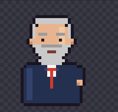 de terno |  com o decreto | 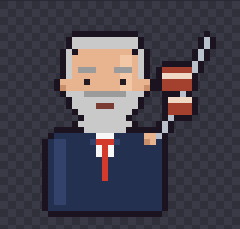 com a picanha |
| **Xandão** | 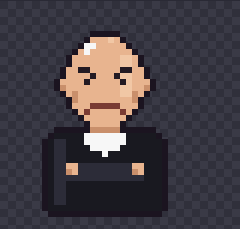 de braços cruzados | 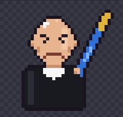 com a caneta | 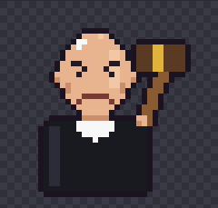 com o martelo |
| **Renan Santos** | 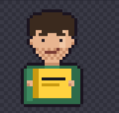 com o livro amarelo | 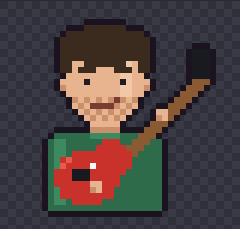 guitarrista | 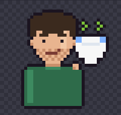 com a fralda |

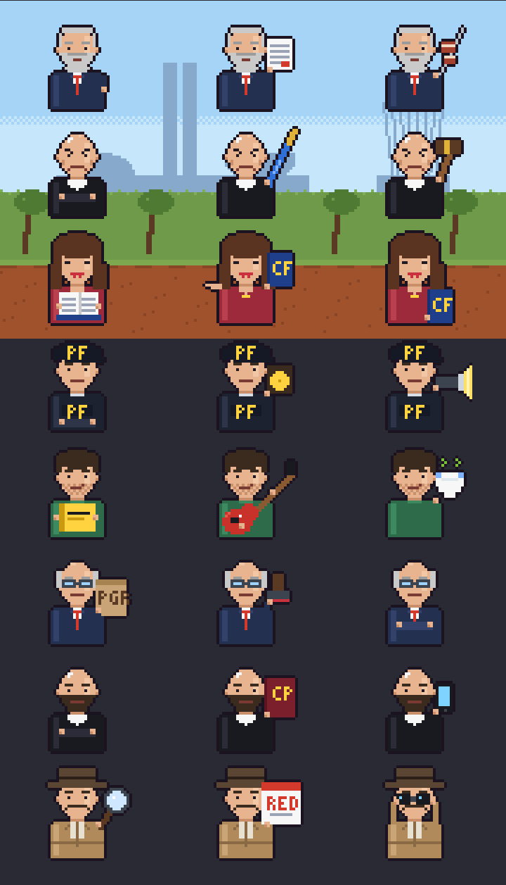

- Código: `src/entities/chaser-sprites.ts`. Meio corpo 36×34, semelhança só sugerida.
- A variante é sorteada cada vez que o perseguidor entra; aparece no aviso ("Xandão com a caneta
  na cola!") e pode mudar a frase do fim de jogo.
- Sua opinião: ☐ manter ☐ melhorar ☐ refazer — _______________________

## 4. HUD: barra de perigo

| Baixo | Médio | Alto |
| :-: | :-: | :-: |
|  |  |  |

- Código: `src/entities/chaser.ts`. Barra com moldura pixel; verde → amarelo → vermelho, com
  brilho no topo; no vermelho o nome treme.
- Sua opinião: ☐ manter ☐ melhorar ☐ refazer — _______________________

## 5. Obstáculos

| Toga + processos | Balões da CPI | Helicóptero da PF | Radar |
| :-: | :-: | :-: | :-: |
|  |  |  |  |

- Código: `src/entities/obstacle-sprites.ts` (desenhos) e `src/entities/obstacles.ts` (movimento e
  áreas de batida).
- **Toga (em cima)**: retangular — laterais retas, mangas em bloco, gola branca quadrada, botões
  dourados e barra reta com faixa dourada na ponta.
- **Pilha de processos (embaixo)**: pastas coloridas com etiquetas; a pilha muda a cada barreira.
- **Balões da CPI**: com brilho e cordinha, balançando.
- **Helicóptero da PF**: hélice com borrão e luz piscando (2 quadros).
- **Radar**: torre treliçada, prato que gira e feixe em cone pontilhado (não bate, só denuncia).
- Sua opinião: ☐ manter ☐ melhorar ☐ refazer — _______________________

## 6. Fundos das paradas (rota real)

| Brasília (0+) | Puerto Iguazú (20+) | Guayaquil (40+) | Miami (60+) |
| :-: | :-: | :-: | :-: |
|  | 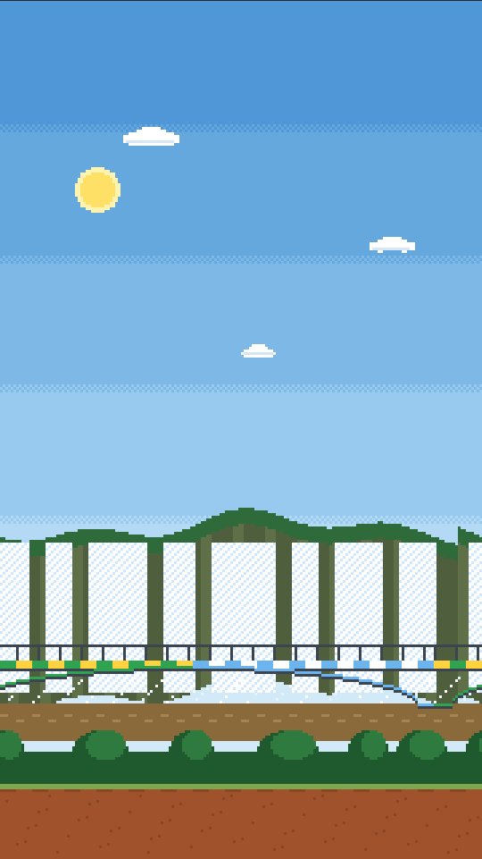 | 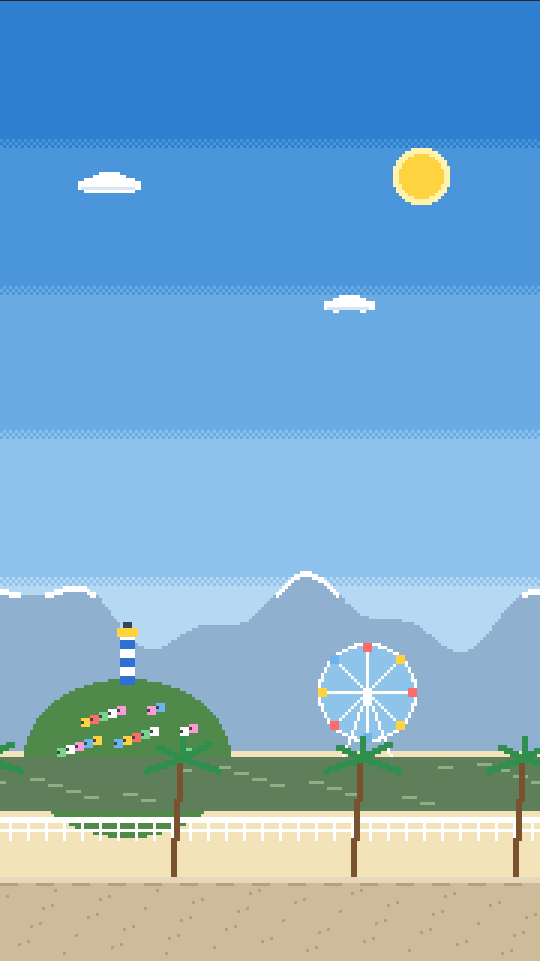 | 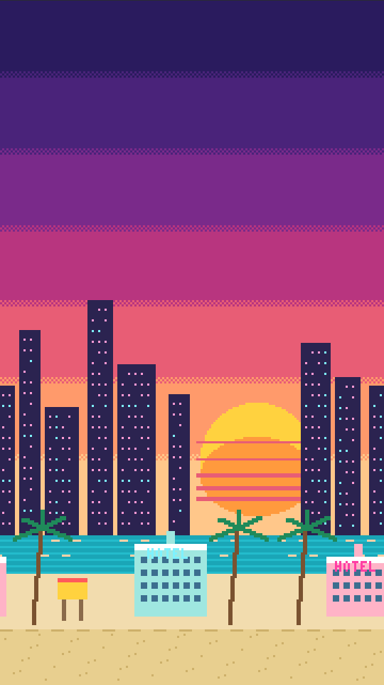 |

- Código: `src/render/scenery.ts`. Céu fixo, sol e 3–5 camadas que andam em velocidades diferentes.
- **Brasília**: Congresso, Catedral, cerrado e terra vermelha.
- **Puerto Iguazú (Argentina)**: Cataratas, Ponte Tancredo Neves metade verde-amarela e metade azul e
  branca, rio e mata.
- **Guayaquil (Equador)**: Andes, Cerro Santa Ana com casinhas e farol, roda-gigante do Malecón, rio
  Guayas, palmeiras.
- **Miami (EUA)**: pôr do sol neon, prédios de Brickell, mar turquesa, hotéis art déco, palmeiras.
- Sua opinião: ☐ manter ☐ melhorar ☐ refazer — _______________________

## 7. Mapa das Américas (pausa e landing)

| Saindo de Brasília | Indo para Guayaquil | Em Miami |
| :-: | :-: | :-: |
|  | 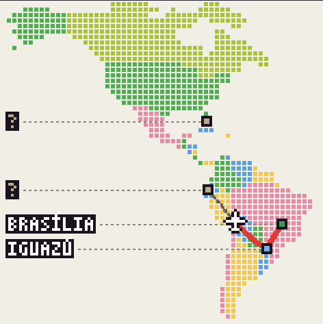 | 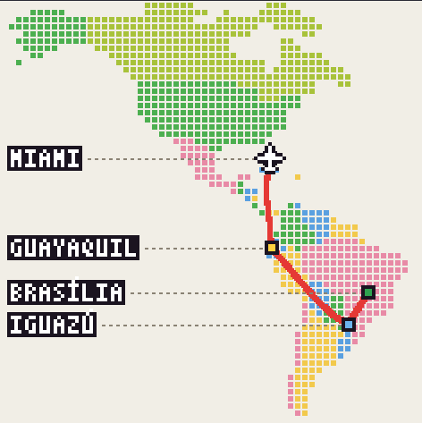 |

- Código: `src/render/map.ts` (desenho), `src/render/americas.ts` (contorno e rota real) e
  `src/render/countries.ts` (que país é cada quadradinho).
- Estilo **mosaico**: quadradinhos com espaço entre eles, cada país numa cor (Alasca ao Cabo Horn),
  fundo claro. Rota feita em vermelho, próxima perna tracejada, paradas futuras como "?", nomes à
  esquerda ligados por linha pontilhada e aviãozinho na posição.
- Sua opinião: ☐ manter ☐ melhorar ☐ refazer — _______________________

## 8. Site

| Landing (celular) | Landing (computador) | Ranking (celular) |
| :-: | :-: | :-: |
|  |  |  |

- A landing usa o fundo e o jatinho em pixel no topo e o mapa em pixel; o sol aparece uma vez só
  mesmo em tela larga.
- Sua opinião: ☐ manter ☐ melhorar ☐ refazer — _______________________

---

## Ideias para a próxima rodada

- Animação dos perseguidores (piscar, balançar o objeto) e dos ataques (decreto, caneta, drone).
- Obstáculos próprios de cada região (guarda-sol, gaivotas, navio, holofote na cerca).
- Favicon e imagem de compartilhamento (jatinho com os perseguidores atrás).
