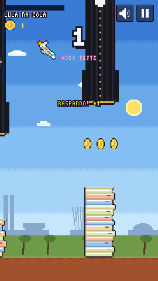
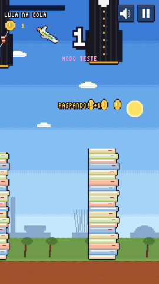
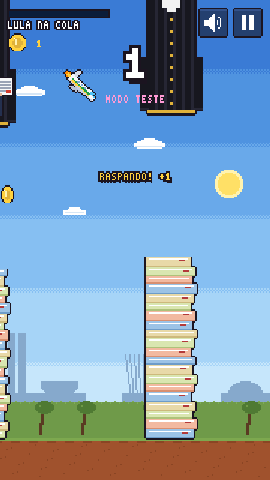
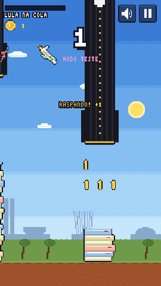
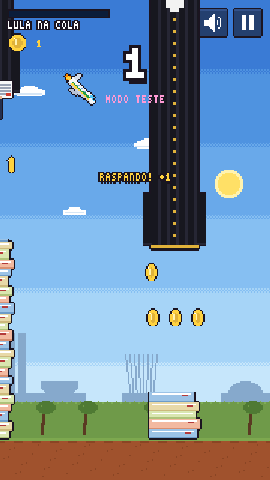

# Eventos aleatórios — prévia para aprovação

Cada evento dá **2 s de aviso** (faixa "! NOME !" + som) e depois dura alguns segundos,
somando-se aos obstáculos normais. Por enquanto só aparecem no **Modo teste**
(`/teste` → "Eventos aleatórios").

| Chuva de fraldas | Chuva de Constituição | Gravidade suspensa por liminar | Apagão | Chuva de moedas |
| :-: | :-: | :-: | :-: | :-: |
|  |  |  |  |  |
| 8 s. Fraldas "LULA" e "FLÁVIO" caem balançando; encostar = dano. | 8 s. Livrinhos da Constituição caem; encostar = dano. | 6 s. A gravidade inverte: o jatinho "cai" para cima e o toque empurra para baixo. | 7 s. A tela escurece e só se enxerga um círculo em volta do jatinho. | 6 s (bom). Chovem moedas pela tela. |

Proposta para depois da aprovação: no jogo normal, 1 evento a cada 45–60 s (nunca durante viagem
ou chefe), categoria **Eventos** na Coleção e medalhas (ex.: "Sobreviveu ao apagão").
