# Prévia: Jatinho do Flávio todo em pixel art

> ✅ **Aprovada e aplicada no jogo**, com a toga mais quadrada. Este arquivo fica como registro da
> prévia; o estado atual está em [../ASSETS.md](../ASSETS.md).

A cena é desenhada em **meia resolução (180×320)** e ampliada sem borrar, então todos os
elementos ficam com o mesmo tamanho de pixel e "conversam" com os perseguidores novos.

## Antes × depois (Brasília)

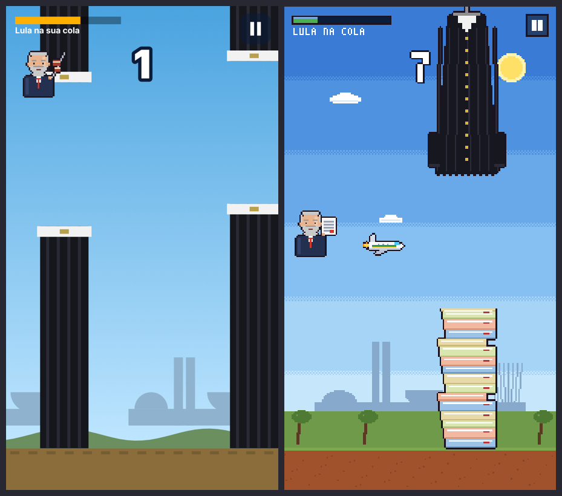

## Telas

| Menu | Brasília | Litoral | Oceano | Fronteira |
| :-: | :-: | :-: | :-: | :-: |
| 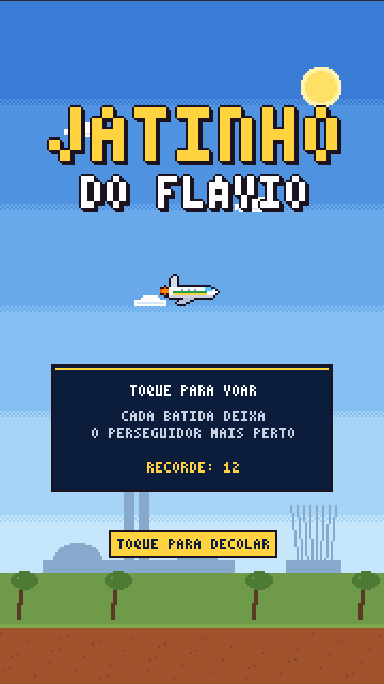 | 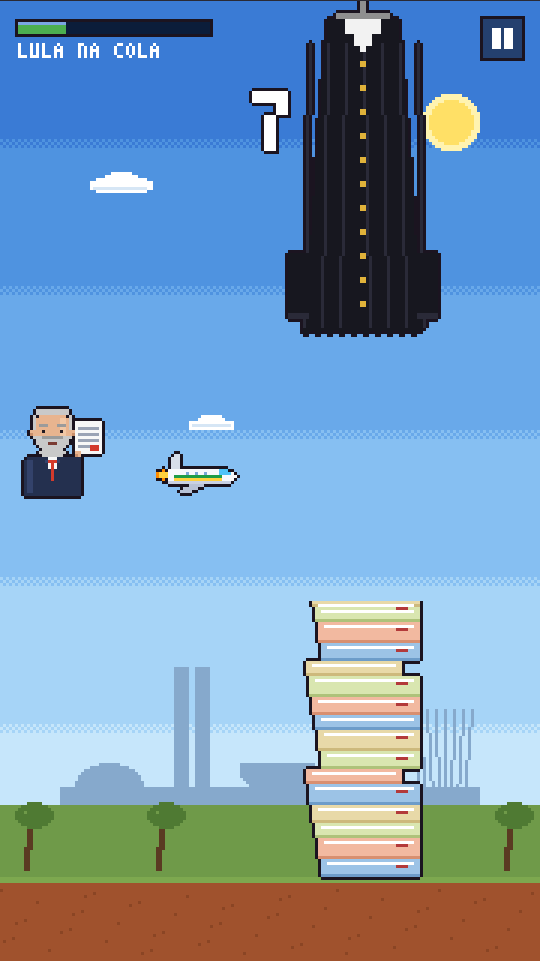 | 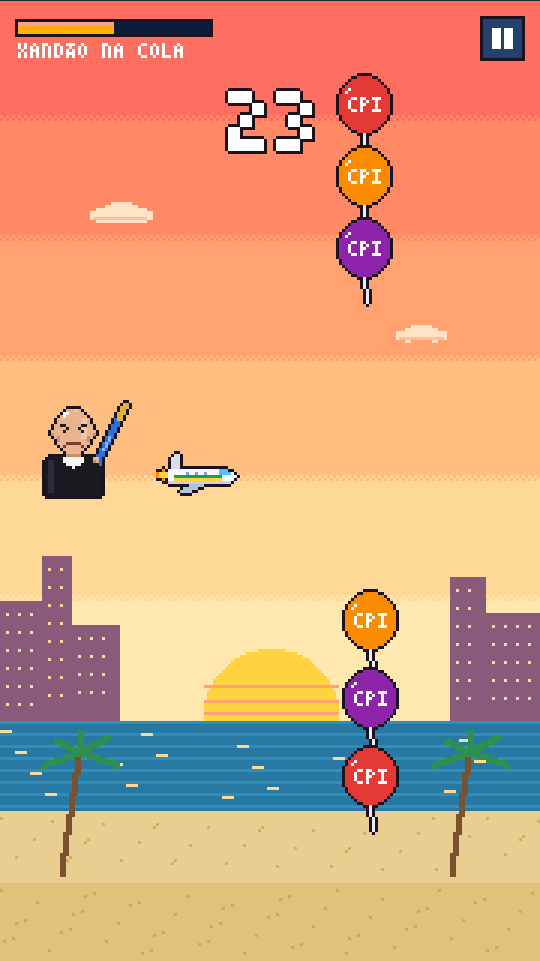 | 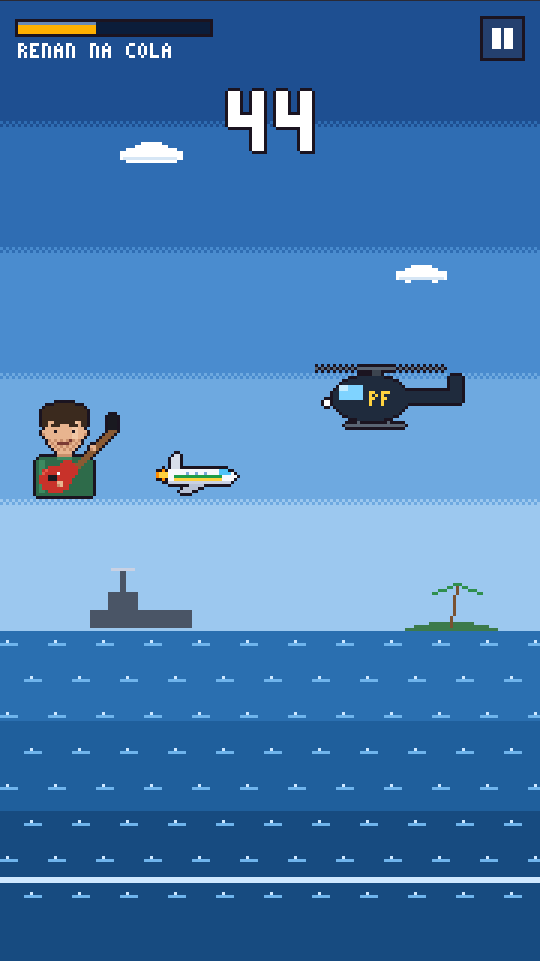 | 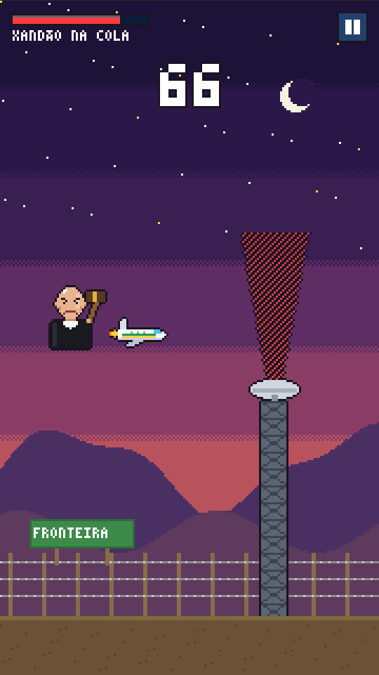 |

Nas telas acima mostrei um tipo de obstáculo por região só para caber tudo; no jogo eles
continuam misturados.

## Fundos

| Brasília | Litoral | Oceano | Fronteira |
| :-: | :-: | :-: | :-: |
| 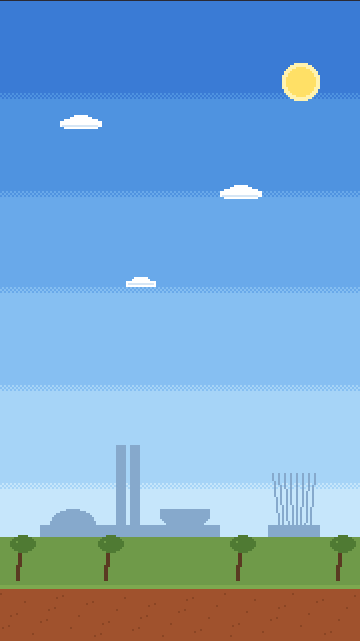 | 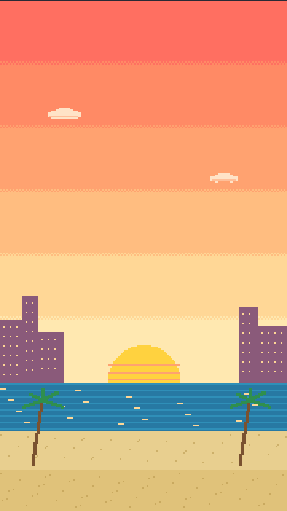 | 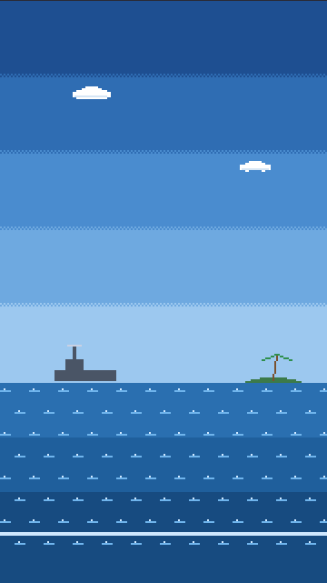 | 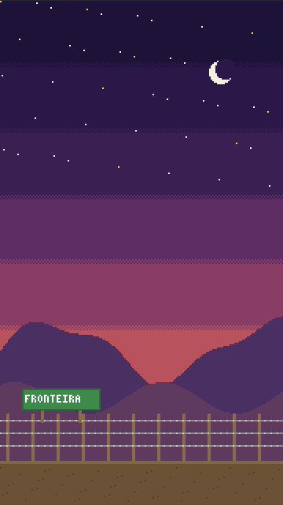 |

- **Brasília**: céu em faixas, sol, nuvens, Congresso (torres, cúpula e "tigela") e Catedral ao
  fundo, árvores do cerrado e terra vermelha.
- **Litoral**: pôr do sol sobre o mar, prédios da orla com janelas acesas, coqueiros e areia.
- **Oceano**: navio com radar e ilha no horizonte, ondas em faixas; o "chão" vira a linha de espuma.
- **Fronteira**: noite com estrelas e lua, montanhas em duas camadas, cerca de arame farpado e
  placa "FRONTEIRA".

## Jatinho e obstáculos

| Jatinho (2 quadros da chama) | Toga (de cima) | Processos (de baixo) |
| :-: | :-: | :-: |
| 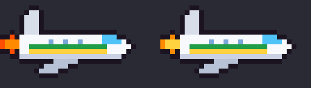 | 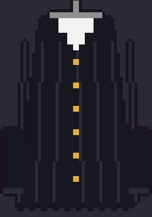 |  |

| Balões da CPI | Helicóptero da PF | Radar |
| :-: | :-: | :-: |
| 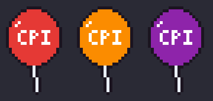 | 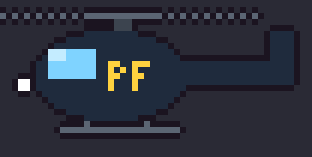 | 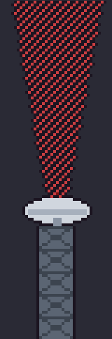 |

- **Jatinho**: janelinhas, cabine, faixa verde-amarela, asa e chama piscando.
- **Toga** (mudou): agora é uma toga de verdade pendurada num cabide, com gola branca, botões
  dourados, mangas e barra abrindo em sino. Não parece mais "cano".
- **Pilha de processos** (novo): sobe do chão no lugar da metade de baixo da toga, com pastas
  coloridas e etiquetas.
- **Balões da CPI**: com brilho, cordinha e "CPI" em letra pixel.
- **Helicóptero da PF**: maior, com vidro, esqui, luz piscando e hélice com borrão.
- **Radar**: torre treliçada, prato de antena e feixe em cone pontilhado.

## HUD e textos

- Barra de perigo e botão de pausa com contorno pixel; placar com números pixelados grandes.
- Fonte pixel 3×5 para títulos, placar e HUD. Os textos compridos (fim de jogo, landing, ranking)
  continuariam na fonte normal, porque a fonte pixel pequena cansa para ler.

## O que muda se aprovar

1. Os desenhos do jogo passam para pixel (jatinho, obstáculos, fundos, HUD, placar, menu, pausa e mapa).
2. As caixas de colisão são ajustadas aos formatos novos (a toga em sino é mais larga embaixo).
3. A landing e o print do topo passam a usar a cena em pixel.
4. `docs/ASSETS.md` é refeito com os prints novos.

## Para você decidir

- [ ] Aprovo passar tudo para pixel art
- [ ] Toga de cima + pilha de processos embaixo (em vez da toga dos dois lados)
- [ ] Fonte pixel no placar/HUD/títulos (textos longos na fonte normal)
- [ ] Pixel deste tamanho (meia resolução) ☐ ou mais grosso, mais "retrô" (1/3 da resolução)
- Outros ajustes: _______________________
